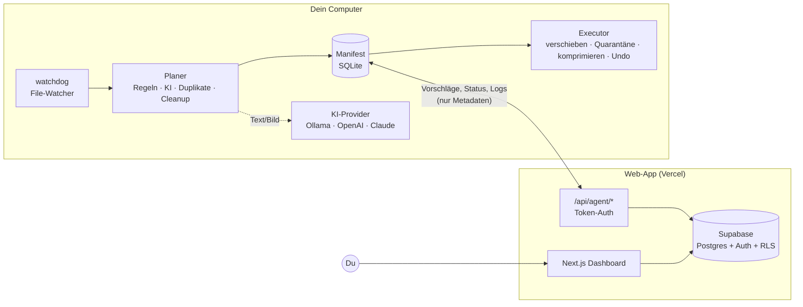

# DateiSortieren

KI-gestützte Datei-Organisation für Downloads und Dokumente. Ein **lokaler Python-Agent** liest,
benennt und sortiert deine Dateien. Ein **Web-Dashboard** (Next.js + Tailwind + Supabase) zeigt dir jede
geplante Änderung als Vorschau, nimmt Freigaben entgegen und macht alles mit einem Klick rückgängig.

```
~/Downloads/SCAN_2026_09_12.pdf
   → ~/Dokumente/Sortiert/Finanzen/Rechnungen/2026/2026-09-12_Telekom_Rechnung_89Euro.pdf
```

---

## Inhalt

1. [Funktionen](#funktionen)
2. [Architektur](#architektur)
3. [Projektstruktur](#projektstruktur)
4. [Schnellstart: nur lokal, ohne Konto](#schnellstart-nur-lokal-ohne-konto)
5. [Schritt-für-Schritt: Einrichtung als Web-App](#schritt-für-schritt-einrichtung-als-web-app)
6. [KI-Provider und Datenschutz](#ki-provider-und-datenschutz)
7. [Sicherheitskonzept](#sicherheitskonzept)
8. [CLI-Referenz](#cli-referenz)
9. [Regeln, Vorlagen und Safe-List](#regeln-vorlagen-und-safe-list)
10. [Lokale Entwicklung](#lokale-entwicklung)
11. [Agent-API](#agent-api)
12. [Fehlerbehebung](#fehlerbehebung)

---

## Funktionen

| Bereich | Was passiert |
|---|---|
| **Smart Categorization** | Inhalt wird gelesen: Text aus PDF/DOCX/TXT, optional OCR (Tesseract). Mit Claude werden gescannte PDFs und Fotos sogar ohne lokales OCR direkt verstanden. Ergebnis: Kategorie (z. B. `Finanzen/Rechnungen`), Dokumenttyp, Absender, Datum, Betrag und Tags. |
| **Automatisches Umbenennen** | Kryptische Namen (`SCAN_…`, `IMG_1234`, `download (3)`, UUIDs) werden nach Vorlage umbenannt: `{date}_{vendor}_{doc_type}_{amount}` ergibt `2026-09-12_Telekom_Rechnung_89Euro.pdf`. |
| **Duplikat-Erkennung** | Exakte Kopien per SHA-256 und ähnliche Inhalte per pHash (Bilder) bzw. SimHash (PDFs/Texte). Behalten wird die ältere oder bereits einsortierte Datei. |
| **Medien-Optimierung** | JPG/PNG/WEBP verlustfrei oder verlustbehaftet über Pillow, Videos über ffmpeg (H.264, CRF). Umgesetzt wird nur, wenn es wirklich etwas spart. Das Original bleibt wiederherstellbar. |
| **Smart Trash & Cleanup** | Temporäre Dateien (`~$…`, `.tmp`, `.DS_Store`), Installer älter als X Tage (`.dmg .exe .msi .pkg .deb …`), abgebrochene Downloads (`.crdownload .part …`) und leere Ordner. Gelöscht wird nur nach Freigabe. |
| **Dry-Run** | Standardmodus: Der Agent schlägt nur vor. Im Dashboard siehst du, was passieren würde. |
| **Undo / Rollback** | SQLite-Manifest aller Aktionen. Einzelne Aktionen oder ganze Durchläufe lassen sich per Klick oder CLI zurücknehmen. |
| **Safe-List** | Ordner, Muster, Dateiendungen und Tags, die nie angefasst werden. Dazu kommt die Marker-Datei `.dateisortieren-ignore`. |
| **Multi-User** | Login per Google oder E-Mail/Passwort. Jeder Nutzer hat eigene Regeln, Ausnahmen, Agenten und Logs, strikt getrennt per Row Level Security. |

## Architektur



* **Dateien verlassen nie deinen Rechner.** Ans Dashboard gehen nur Pfade, Vorschläge und Logs.
  An einen Cloud-KI-Provider geht nur dann etwas, wenn du ihn ausdrücklich wählst (siehe unten).
* Der Agent arbeitet auch **komplett offline** (Heuristik oder Ollama, CLI statt Dashboard).
* Der Agent fragt das Dashboard regelmäßig ab (Polling). Dadurch braucht es keine offenen Ports und funktioniert hinter jedem Router.

## Projektstruktur

```
DateiSortieren/
├── agent/                         # Python-Agent (pip-Paket "dateisortieren")
│   ├── dateisortieren/
│   │   ├── cli.py                 # Kommandozeile
│   │   ├── watcher.py             # Daemon: watchdog + Sync + geplante Scans
│   │   ├── service.py             # Orchestrierung (Planen, Ausführen, Undo, Sync)
│   │   ├── planner.py             # Erzeugt Aktionen (Dry-Run)
│   │   ├── executor.py            # Führt sicher aus, Quarantäne, Undo
│   │   ├── manifest.py            # SQLite-Logbuch + Fingerprint-Index
│   │   ├── classifier.py          # Regeln → KI → Heuristik
│   │   ├── ai/                    # heuristic, anthropic, openai, ollama
│   │   ├── extract.py             # PDF/DOCX/Text + OCR
│   │   ├── renamer.py             # Dateinamen & Zielpfade
│   │   ├── duplicates.py          # SHA-256, pHash, SimHash
│   │   ├── media.py               # Bild-/Video-Komprimierung
│   │   ├── cleanup.py             # Temp, Installer, Teil-Downloads, leere Ordner
│   │   ├── safelist.py            # Whitelist
│   │   ├── sync.py                # Client für die Dashboard-API
│   │   └── data/config.example.yaml
│   ├── service/                   # Autostart: systemd, launchd, Windows
│   └── tests/                     # pytest (End-to-End inkl. Undo)
├── web/                           # Next.js 16 Dashboard
│   └── src/
│       ├── app/
│       │   ├── page.tsx           # Landingpage
│       │   ├── login/             # Google + E-Mail/Passwort
│       │   ├── auth/callback/     # OAuth-/E-Mail-Bestätigung
│       │   ├── dashboard/         # Übersicht, Vorschau, Duplikate, Cleanup, Optimierung,
│       │   │                      # Verlauf & Undo, KI-Regeln, Safe-List, Agenten, Aktivität, Einstellungen
│       │   └── api/agent/         # config, heartbeat, actions, commands, logs
│       ├── components/
│       ├── lib/
│       └── proxy.ts               # Session-Refresh + Schutz von /dashboard
├── supabase/
│   ├── migrations/0001_init.sql   # Tabellen, RLS, Trigger, Realtime
│   └── config.toml                # für `supabase start` (lokal)
└── .github/workflows/ci.yml       # Tests + Build
```

---

## Schnellstart: nur lokal, ohne Konto

Voraussetzung: **Python 3.10+**.

```bash
git clone https://github.com/vexsternbrink-hue/DateiSortieren.git
cd DateiSortieren/agent
python -m venv .venv && source .venv/bin/activate     # Windows: .venv\Scripts\activate
pip install -e .

dateisortieren init          # legt ~/.dateisortieren/config.yaml an
dateisortieren scan          # Vorschau: was WÜRDE passieren? (ändert nichts)
dateisortieren apply --all   # Vorschläge ausführen
dateisortieren history       # Verlauf
dateisortieren undo          # letzten Durchlauf komplett rückgängig machen
```

Ohne weitere Einstellungen arbeitet der Agent mit der eingebauten **Heuristik** (Schlüsselwörter, Datums- und
Betragserkennung). Bessere Ergebnisse bekommst du mit einem KI-Provider (siehe [Schritt 5](#schritt-5-agent-auf-deinem-computer-einrichten)).

---

## Schritt-für-Schritt: Einrichtung als Web-App

Die Web-App läuft kostenlos auf **Vercel**, Datenbank und Login laufen kostenlos auf **Supabase**.
Insgesamt dauert die Einrichtung etwa 20 Minuten.

### Schritt 1: Supabase-Projekt anlegen

1. Auf [supabase.com](https://supabase.com/dashboard) registrieren, dann **New project** wählen (Region z. B. Frankfurt).
2. Links **SQL Editor** öffnen, **New query** wählen, den kompletten Inhalt von
   [`supabase/migrations/0001_init.sql`](supabase/migrations/0001_init.sql) einfügen und **Run** klicken.
   Damit werden alle Tabellen, die Sicherheitsregeln (RLS) und die Live-Updates angelegt.
3. **Project Settings → API Keys** öffnen und drei Werte notieren:
   * **Project URL** (`https://xxxx.supabase.co`)
   * **Publishable key** (`sb_publishable_…`; bei älteren Projekten heißt er *anon key*)
   * **Secret key** (`sb_secret_…`; früher *service_role key*). **Den Secret key niemals veröffentlichen.**

### Schritt 2: Login einrichten (E-Mail und Google)

**E-Mail/Passwort** ist sofort aktiv. Unter *Authentication → Sign In / Providers → Email* kannst du
„Confirm email“ ein- oder ausschalten.

**Google OAuth:**

1. In der [Google Cloud Console](https://console.cloud.google.com/apis/credentials) ein Projekt anlegen.
2. Den **OAuth-Zustimmungsbildschirm** einrichten (Typ „Extern“, App-Name, Support-E-Mail).
3. Unter **Anmeldedaten → Anmeldedaten erstellen → OAuth-Client-ID** den Typ **Webanwendung** wählen.
   * **Autorisierte Weiterleitungs-URI:** `https://<dein-projekt>.supabase.co/auth/v1/callback`
     (steht in Supabase unter *Authentication → Providers → Google → Callback URL*).
4. Client-ID und Client-Secret in Supabase unter **Authentication → Sign In / Providers → Google** eintragen und aktivieren.
5. In Supabase unter **Authentication → URL Configuration**:
   * **Site URL:** deine spätere App-URL, z. B. `https://dateisortieren.vercel.app` (für den Anfang `http://localhost:3000`)
   * **Redirect URLs:** `http://localhost:3000/auth/callback` und `https://<deine-app>.vercel.app/auth/callback`

### Schritt 3: Dashboard lokal starten (optional, zum Ausprobieren)

Voraussetzung: **Node.js 20+**.

```bash
cd web
cp .env.example .env.local      # die 3 Werte aus Schritt 1 eintragen
npm install
npm run dev                     # http://localhost:3000
```

### Schritt 4: Online stellen mit Vercel

1. Auf [vercel.com](https://vercel.com) mit GitHub anmelden, **Add New → Project** wählen und dieses Repository importieren.
2. **Root Directory** auf `web` setzen. Das Framework „Next.js“ wird automatisch erkannt.
3. Unter **Environment Variables** eintragen:

   | Name | Wert |
   |---|---|
   | `NEXT_PUBLIC_SUPABASE_URL` | Project URL |
   | `NEXT_PUBLIC_SUPABASE_PUBLISHABLE_KEY` | Publishable key |
   | `SUPABASE_SECRET_KEY` | Secret key |

4. Auf **Deploy** klicken. Danach ist die App unter `https://<name>.vercel.app` erreichbar.
5. Diese URL in Supabase als **Site URL** und `https://<name>.vercel.app/auth/callback` als **Redirect URL** eintragen (siehe Schritt 2.5).

> Variablen nachträglich geändert? Dann unter **Deployments → … → Redeploy** neu bauen, weil
> `NEXT_PUBLIC_*`-Werte beim Build eingebaut werden.

Jetzt kannst du dich registrieren und das Dashboard öffnen.

### Schritt 5: Agent auf deinem Computer einrichten

```bash
cd DateiSortieren/agent
python -m venv .venv && source .venv/bin/activate
pip install -e ".[anthropic]"          # oder ".[openai]", ".[all]", oder nur "." für Ollama/Heuristik
dateisortieren init
```

1. **Token erzeugen:** Im Dashboard unter **Agenten** einen Namen eingeben und auf **Token erzeugen** klicken.
   Das angezeigte Snippet kopierst du in `~/.dateisortieren/config.yaml`:
   ```yaml
   cloud:
     api_url: https://<name>.vercel.app
     agent_token: ds_…
   ```
2. **Ordner festlegen** in `~/.dateisortieren/config.yaml`:
   ```yaml
   watch_dirs: [~/Downloads]
   target_root: ~/Dokumente/Sortiert
   ai:
     provider: anthropic        # heuristic | anthropic | openai | ollama
   ```
3. **API-Key hinterlegen** in `~/.dateisortieren/.env` (Vorlage: [`agent/.env.example`](agent/.env.example)):
   ```bash
   ANTHROPIC_API_KEY=sk-ant-...   # https://console.anthropic.com → API Keys
   # OPENAI_API_KEY=sk-...        # https://platform.openai.com/api-keys
   ```
4. **Prüfen und loslegen:**
   ```bash
   dateisortieren doctor      # zeigt, ob alles passt (Ordner, Keys, Dashboard-Verbindung)
   dateisortieren scan        # erster Durchlauf, die Vorschläge erscheinen im Dashboard
   dateisortieren run         # Daemon: beobachtet Ordner und führt Freigaben aus
   ```
5. **Autostart** (optional): Vorlagen liegen in [`agent/service/`](agent/service)
   (`systemd` für Linux, `launchd` für macOS, PowerShell-Skript für Windows).

**Ablauf im Alltag:** Eine neue Datei landet in `~/Downloads`. Der Agent wartet, bis der Download fertig ist,
und analysiert sie dann. Der Vorschlag erscheint live unter **Vorschau**. Du klickst auf **Freigeben**, der Agent
führt die Aktion aus, und unter **Verlauf & Undo** kannst du sie jederzeit zurücknehmen.

Wenn der Agent die Ergebnisse gut trifft, kannst du unter **Einstellungen** den Dry-Run ausschalten. Dann werden
Aktionen ab der eingestellten KI-Sicherheit (Standard 85 %) automatisch ausgeführt. Löschungen brauchen
weiterhin immer eine Freigabe.

### Optional: OCR und Videos

* **OCR** für gescannte PDFs und Fotos bei OpenAI, Ollama oder Heuristik
  (Claude liest PDFs und Bilder auch ohne OCR):
  `pip install -e ".[ocr]"` sowie Tesseract installieren (`brew install tesseract tesseract-lang`,
  `sudo apt install tesseract-ocr tesseract-ocr-deu poppler-utils`, Windows: UB-Mannheim-Installer).
  Danach in der `config.yaml` `ocr.enabled: true` setzen.
* **Video-Komprimierung** braucht `ffmpeg` (`brew install ffmpeg`, `sudo apt install ffmpeg`, `winget install ffmpeg`).

---

## KI-Provider und Datenschutz

| Provider | `ai.provider` | Was verlässt den Rechner? | Hinweise |
|---|---|---|---|
| Heuristik | `heuristic` | nichts | Schlüsselwörter, Datum, Betrag, bekannte Firmen. Kostenlos. |
| Ollama (lokales LLM) | `ollama` | nichts | [ollama.com](https://ollama.com) installieren, dann `ollama pull llama3.2`. Für Bilder ein Vision-Modell wie `llama3.2-vision`. |
| OpenAI | `openai` | Dateiname + Textauszug (max. `ai.max_chars`), ggf. verkleinerte Bilder | Standardmodell `gpt-4.1-mini`, änderbar über `ai.model`. `ai.openai_base_url` funktioniert auch mit LM Studio und anderen OpenAI-kompatiblen Servern. |
| Anthropic (Claude) | `anthropic` | Dateiname + Textauszug, bei Scans ohne Text das PDF bzw. das verkleinerte Bild | Standardmodell `claude-opus-5-5` mit `effort: low` und strukturierter JSON-Ausgabe. Günstiger geht es z. B. mit `ai.model: claude-haiku-4-5`. Serverseitige Fallbacks bei Ablehnungen sind aktiv. |

* Mit `ai.send_files: false` werden nie ganze Dateien gesendet, sondern nur extrahierter Text.
* Mit `ai.max_chars` begrenzt du, wie viel Text pro Datei gesendet wird.
* API-Keys liegen nur lokal (`~/.dateisortieren/.env`) und werden nie ans Dashboard übertragen.
* Fällt die KI aus (kein Key, keine Verbindung), nutzt der Agent automatisch die Heuristik.

## Sicherheitskonzept

1. **Dry-Run ist Standard.** Ohne Freigabe wird nichts verändert.
2. **Nichts wird überschrieben.** Bei Namenskonflikten entsteht `Datei (1).pdf`.
3. **Löschen bedeutet Quarantäne.** Gelöschte Dateien landen in `~/.dateisortieren/trash/` und werden erst
   nach `trash.retention_days` (Standard 30) endgültig entfernt.
4. **Komprimierung mit Backup.** Das Original liegt in der Quarantäne, Undo stellt es bitgenau wieder her.
5. **Manifest.** Jede Aktion steht vor und nach der Ausführung in `~/.dateisortieren/manifest.db`.
   Undo läuft in umgekehrter Reihenfolge.
6. **Prüfsumme.** Nach dem Verschieben wird der SHA-256 verglichen. Bei Abweichung wird zurückgerollt.
7. **Erneute Prüfung beim Ausführen.** Die Safe-List wird direkt vor jeder Aktion noch einmal geprüft, Duplikate nur
   gelöscht, wenn das Original noch existiert, und Ordner nur, wenn sie noch leer sind.
8. **Datenbank:** Row Level Security pro Nutzer. Ein Trigger erlaubt aus dem Browser nur gültige Statuswechsel und
   verhindert, dass Pfade manipuliert werden. Agent-Tokens werden nur als SHA-256-Hash gespeichert.

## CLI-Referenz

| Befehl | Beschreibung |
|---|---|
| `dateisortieren init [--force]` | Beispiel-Konfiguration nach `~/.dateisortieren/config.yaml` |
| `dateisortieren doctor` | Systemcheck (Ordner, Keys, OCR, ffmpeg, Dashboard) |
| `dateisortieren scan [ordner…] [--apply] [--offline]` | Analyse und Vorschau. `--apply` führt sichere Aktionen direkt aus |
| `dateisortieren classify <datei>` | Eine Datei testweise klassifizieren (zeigt KI-Ergebnis) |
| `dateisortieren pending` | Offene Vorschläge |
| `dateisortieren apply <id…> \| --batch <id> \| --all` | Vorschläge ausführen (Kurz-IDs wie in der Tabelle) |
| `dateisortieren history` | Verlauf |
| `dateisortieren undo [id \| batch-id]` | Rückgängig machen (ohne Argument: letzter Durchlauf) |
| `dateisortieren sync` | Einmal mit dem Dashboard abgleichen (Freigaben und Undo ausführen, z. B. per Cron) |
| `dateisortieren run` | Daemon: Watcher, Dashboard-Sync, stündlicher Scan, Quarantäne-Bereinigung |
| `dateisortieren purge-trash` | Abgelaufene Quarantäne-Einträge endgültig löschen |

Globale Optionen: `--config <pfad>` und `-v` (Debug-Ausgabe). Umgebungsvariablen: `DATEISORTIEREN_HOME`,
`DATEISORTIEREN_CONFIG`, `DATEISORTIEREN_API_URL`, `DATEISORTIEREN_AGENT_TOKEN`, `DATEISORTIEREN_AI_PROVIDER`.

## Regeln, Vorlagen und Safe-List

**Anweisungen an die KI** (Dashboard → KI-Regeln) in natürlicher Sprache, zum Beispiel:

```
Rechnungen meines Arbeitgebers "Muster GmbH" gehören nach Arbeit/Muster GmbH.
Alles rund um die Kita nach Familie/Kita.
```

**Wenn-Dann-Regeln** haben Vorrang vor der KI. Regeln ohne KI-Kategorie-Bedingung sparen den KI-Aufruf komplett.

| Bedingung | Beispiel |
|---|---|
| Dateiendungen | `.pdf, .jpg` |
| Dateiname enthält | `telekom` |
| Inhalt enthält | `Kundennummer 12345` |
| KI-Kategorie beginnt mit | `Finanzen/Rechnungen` |
| Regulärer Ausdruck | `^IMG_\d+` |
| Größe | min. und max. KB |

Mögliche Aktionen: **Sortieren** (Zielordner und Namensvorlage), **Ignorieren** oder **Löschen vorschlagen**.

**Platzhalter** für Ordner- und Namensvorlagen: `{category} {year} {month} {date} {vendor} {doc_type} {title} {amount}`.

**Safe-List:** Pfade (`~/Downloads/Projekte`), Muster (`Steuer_*.pdf`), Endungen (`.kdbx`) und Tags (`vertraulich`).
Zusätzlich wird jeder Ordner ignoriert, der eine Datei namens `.dateisortieren-ignore` enthält.

## Lokale Entwicklung

```bash
# Supabase komplett lokal (Docker nötig) – wendet die Migration automatisch an
npx supabase start
# URL und Keys aus der Ausgabe nach web/.env.local kopieren
cd web && npm install && npm run dev

# Agent-Tests
cd agent && pip install -e ".[dev,anthropic,openai]" && pytest
```

Die Tests decken den kompletten Ablauf ab: Dry-Run, Ausführen, Undo, Duplikate, Komprimierung samt
Wiederherstellung, Safe-List, Regeln, KI-Request-Format (gemockt) und den Fallback auf die Heuristik.

## Agent-API

Alle Endpunkte erwarten `Authorization: Bearer ds_…` (Agent-Token).

| Methode | Pfad | Zweck |
|---|---|---|
| `GET` | `/api/agent/config` | Einstellungen, aktive Regeln und Safe-List des Nutzers |
| `POST` | `/api/agent/heartbeat` | Lebenszeichen. Die Antwort enthält `scan_requested`, falls im Dashboard ein Scan angefordert wurde |
| `POST` | `/api/agent/actions` | Vorschläge und Ergebnisse hochladen (Upsert). Entscheidungen des Nutzers werden nicht überschrieben |
| `GET` | `/api/agent/commands` | Freigegebene Aktionen, Undo-Wünsche und abgelehnte IDs |
| `POST` | `/api/agent/logs` | Eintrag ins Aktivitäts-Log |

## Fehlerbehebung

| Problem | Lösung |
|---|---|
| Dashboard zeigt „Supabase ist noch nicht verbunden“ | Umgebungsvariablen in Vercel setzen und **Redeploy** auslösen |
| Google-Login endet mit Fehler | Redirect-URI in der Google Console (`…supabase.co/auth/v1/callback`) und die Redirect URLs in Supabase prüfen |
| `Agent-Token ungültig` | Token im Dashboard neu erzeugen. Das alte Token wird beim Löschen des Agenten ungültig |
| Agent sieht keine Dateien (macOS) | Terminal/Python unter *Datenschutz & Sicherheit → Festplattenvollzugriff* freigeben |
| KI-Ergebnis „heuristic (Fallback …)“ | `dateisortieren doctor` ausführen. Meist fehlt der API-Key oder das Paket (`pip install -e ".[anthropic]"`) |
| Freigaben werden nicht ausgeführt | Läuft `dateisortieren run`? Unter **Agenten** sollte der Status „online“ sein |
| Etwas wurde falsch sortiert | **Verlauf & Undo**, dann **Undo** oder `dateisortieren undo <id>` |

## Lizenz

MIT
